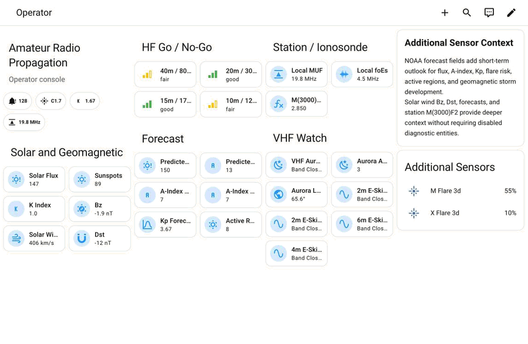

# Amateur Radio Propagation

[](https://github.com/chemicalsno/amateur_radio_propagation/releases)
[](https://github.com/chemicalsno/amateur_radio_propagation/actions/workflows/ci.yml)
[](https://github.com/chemicalsno/amateur_radio_propagation/actions/workflows/hassfest.yml)
[](https://github.com/chemicalsno/amateur_radio_propagation/actions/workflows/hacs.yml)
[](https://github.com/hacs/integration)
[](https://www.home-assistant.io/)
[](https://github.com/chemicalsno/amateur_radio_propagation#MIT-1-ov-file)

Home Assistant custom integration for amateur radio propagation sensors. It polls NOAA SWPC, hamqsl.com, and kc2g.com ionosonde stations for solar, space-weather, HF/VHF, and MUF data.

## Installation

### HACS

[](https://my.home-assistant.io/redirect/hacs_repository/?owner=chemicalsno&repository=amateur_radio_propagation&category=integration)

Or add it manually:

1. Open HACS in Home Assistant.
2. Select the three-dot menu in the top-right corner, then **Custom repositories**.
3. Add `https://github.com/chemicalsno/amateur_radio_propagation` with type **Integration**, then select **Add**.
4. Search for **Amateur Radio Propagation**, select **Download**, and restart Home Assistant.

### Manual

Copy `custom_components/amateur_radio_propagation/` into `config/custom_components/` and restart Home Assistant.

## Configuration

Go to **Settings -> Devices & Services -> Add Integration** and search for **Amateur Radio Propagation**.

The integration supports two entry types:

| Entry type | Purpose |
|------------|---------|
| Solar Data | Global solar, space-weather, HF/VHF, and aurora sensors. Only one Solar Data entry can be configured. |
| MUF Station | Ionosonde data from one kc2g station. Add one entry per station. |

MUF stations are sorted by distance from your Home Assistant location. To change stations later, use **Reconfigure** on the MUF entry.

## Sensors

### Solar Data

Solar Data includes:

- Solar indices: SFI, sunspots, K-index, A-index, Bz, solar wind, foF2
- HF band conditions: daytime and nighttime 80m-10m outlooks, geomagnetic field, noise level
- NOAA space weather: X-ray class, G/S/R scales, flare probabilities, Kp, Dst, A-index and SFI forecasts, active alerts, solar wind, active regions
- VHF and aurora: aurora activity and latitude, VHF aurora, E-skip outlooks
- Diagnostic entities, disabled by default: proton/electron flux, helium line, nighttime K-index, flare begin/end/current ratio, solar wind density, IMF Bt

### MUF Station

MUF Station entries include:

- Enabled by default: MUF, foF2, foE, foEs, confidence score, hmF2, TEC, M(3000)F2
- Diagnostic entities, disabled by default: hmE, foF1, hmF1, scale height F2, yF2

Disabled sensors can be enabled from **Settings -> Devices & Services -> Amateur Radio Propagation -> entities**.

See [docs/SENSORS.md](https://github.com/chemicalsno/amateur_radio_propagation/blob/main/docs/SENSORS.md) for the full sensor catalog.

## Update Intervals

| Source | Interval | Data |
|--------|----------|------|
| NOAA SWPC fast endpoints | 15 min | X-ray, solar wind, Kp, Dst, forecasts, alerts |
| NOAA SWPC solar regions | 3 hr | Active solar region count |
| hamqsl.com | 3 hr | Solar indices, band conditions, aurora |
| kc2g ionosonde (Solar Data) | 15 min | North America 6m sporadic-E outlook |
| kc2g ionosonde (MUF Station) | 30 min | MUF station data |

Solar sensors expose source freshness attributes for NOAA and hamqsl. MUF sensors expose kc2g source freshness. The North America 6m sporadic-E sensor has no kc2g freshness attribute; its `stations_reporting` attribute shows how many North American ionosondes reported fresh data.

## Dashboards

Example Lovelace dashboards live in `dashboards/`. Adding a MUF Station entry also posts a one-time notification with dashboard YAML pre-filled for that station.



See the [dashboard gallery](https://github.com/chemicalsno/amateur_radio_propagation/blob/main/docs/DASHBOARDS.md#screenshots) for screenshots of every dashboard.

| Dashboard | Dependencies | Best for |
|-----------|--------------|----------|
| `vanilla-dashboard.yaml` | None | Quick start |
| `operator-go-no-go-dashboard.yaml` | None | Operating decisions |
| `contest-field-day-dashboard.yaml` | None | Contest or Field Day desk |
| `muf-station-dashboard.yaml` | None | Ionosonde station monitoring |
| `space-weather-alert-center.yaml` | None | NOAA alerts and storm scales |
| `vhf-6m-opening-dashboard.yaml` | None | VHF, 6m, E-skip, aurora |
| `diagnostics-freshness-dashboard.yaml` | None | Source freshness and support |
| `mobile-minimal-dashboard.yaml` | None | Phone-first view |
| `embedded-descriptions-dashboard.yaml` | None | Inline explanations |
| Plugin dashboards | HACS frontend cards | Bubble Card, Mushroom, mini-graph-card, ApexCharts, auto-entities, layout-card, state-switch, browser_mod, button-card |

To install one manually:

1. In Home Assistant, go to **Settings -> Dashboards -> Add Dashboard**.
2. Choose **YAML mode**.
3. Open the dashboard's raw configuration editor.
4. Paste the dashboard YAML.
5. Replace `IF843` / `if843` with your configured MUF station code if needed.

You can also copy dashboard YAML files into `/config/dashboards/` and register them in `configuration.yaml`:

This uses Home Assistant's `lovelace.dashboards` configuration.

```yaml
lovelace:
  mode: storage
  dashboards:
    arp-operator:
      mode: yaml
      title: Propagation Go/No-Go
      icon: mdi:radio-tower
      show_in_sidebar: true
      filename: dashboards/operator-go-no-go-dashboard.yaml
```

For a larger ready-to-use map, copy `dashboards/lovelace-dashboards.example.yaml` into `/config/dashboards/` and include it:

```yaml
lovelace:
  mode: storage
  dashboards: !include dashboards/lovelace-dashboards.example.yaml
```

See [docs/DASHBOARDS.md](https://github.com/chemicalsno/amateur_radio_propagation/blob/main/docs/DASHBOARDS.md) for the full dashboard catalog and plugin notes.

## Example Automations

The day and night HF band outlook sensors (80m-10m) report the states `good`, `fair`, `poor`, and `band_closed`; the UI shows translated labels such as "Good".

These examples use the automation syntax introduced in Home Assistant 2024.10. On 2024.5 through 2024.9, use `trigger:` with `platform:` in place of `triggers:` with `trigger:`, `condition:` in place of `conditions:`, and `action:` with `service:` in place of `actions:` with `action:`. Ready-to-import examples live in `automations/` (2024.10 and later) and `automations/pre-2024.10/` (2024.5 through 2024.9).

### Alert when 10m opens during the day

```yaml
automation:
  - alias: "10m band open alert"
    triggers:
      - trigger: state
        entity_id: sensor.amateur_radio_propagation_solar_hf_12_10_day
        to: "good"
    actions:
      - action: notify.mobile_app_your_phone
        data:
          message: "10m is open!"
```

### Notify when K-Index spikes

```yaml
automation:
  - alias: "Geomagnetic storm warning"
    triggers:
      - trigger: numeric_state
        entity_id: sensor.amateur_radio_propagation_solar_k_index
        above: 4
    actions:
      - action: notify.mobile_app_your_phone
        data:
          message: "K-Index is {{ states('sensor.amateur_radio_propagation_solar_k_index') }}; expect HF disruption"
```

## Troubleshooting

| Problem | What to check |
|---------|---------------|
| Sensors show `unavailable` | Check **Settings -> System -> Logs** for upstream HTTP errors or timeouts. The integration retries automatically. |
| **NOAA solar data is unavailable** repair issue | Raised when NOAA SWPC X-ray data has not been fetched for over an hour. It clears on the next successful fetch. |
| One solar source stays stale after recovering | After 3 consecutive failures, a 15-minute NOAA or kc2g source is skipped for 1 hour before it is retried. |
| MUF station data is stale | A repair issue appears after the stale threshold is exceeded. Reconfigure the entry to switch stations if needed. |
| Solar sensors are missing | Some diagnostics are disabled by default. Enable them from the entity list. |
| hamqsl data stopped updating | hamqsl.com can be delayed or unavailable. Last known values are retained until the feed recovers. |
| Config flow cannot connect to station list | Check internet access and retry; the kc2g station endpoint may be temporarily down. |

## Known Limitations

- Solar Data is global and supports one entry.
- MUF reflects conditions near the selected ionosonde, not a full point-to-point path.
- Ionosonde coverage is sparse, so the nearest station may still be distant.
- Upstream feeds can be delayed or unavailable.
- Data is polled on fixed intervals; there are no push updates.

## Development

```bash
uv sync --frozen
uv run ruff format --check custom_components tests scripts
uv run ruff check custom_components tests scripts
uv run pyright
uv run pytest --asyncio-mode=auto tests/
uv run python scripts/smoke_test.py   # hits real APIs, ~5 seconds
```

Core modules:

| File | Purpose |
|------|---------|
| `__init__.py` | Entry setup, unload, and reload |
| `config_flow.py` | Setup and reconfigure flow |
| `coordinator_solar.py` | NOAA, hamqsl, and kc2g foEs fetching/parsing, circuit breaker, and NOAA staleness repair |
| `coordinator_muf.py` | kc2g station fetching/parsing and stale-data repairs |
| `sensor.py` | Home Assistant sensor entities |
| `diagnostics.py` | Redacted diagnostics export |
| `dashboard_notify.py` | One-time dashboard setup notification for MUF entries |
| `types.py` | Typed config entry alias |

See [docs/ARCHITECTURE.md](https://github.com/chemicalsno/amateur_radio_propagation/blob/main/docs/ARCHITECTURE.md) for implementation details and [docs/TROUBLESHOOTING.md](https://github.com/chemicalsno/amateur_radio_propagation/blob/main/docs/TROUBLESHOOTING.md) for expanded support notes.

## Requirements

- Home Assistant 2024.5.0 or later
- No extra runtime Python packages beyond Home Assistant's bundled stack

## License

MIT
